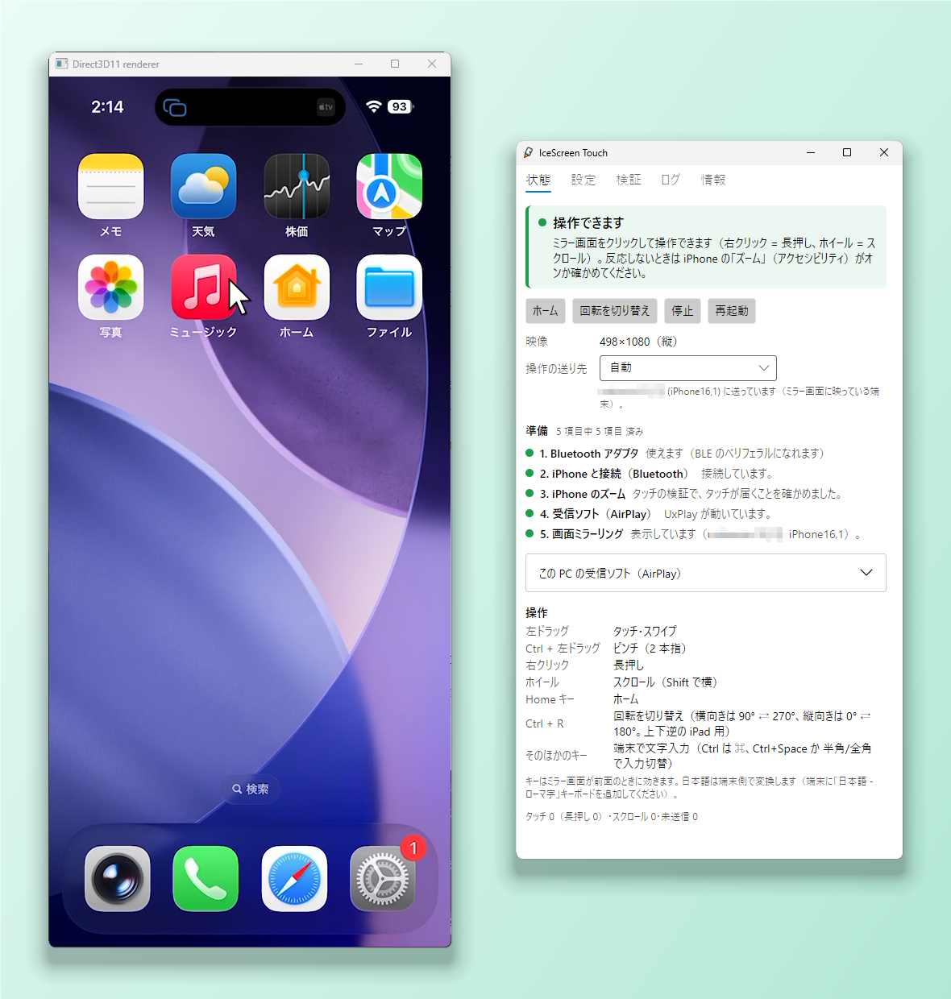

# IceScreen Touch

[English](README.md)

Windows の PC に映した iPhone の画面を、マウスで操作するソフトです。ミラー画面をクリックしたりドラッグしたりすると、iPhone に本物のタッチとして届きます。iPhone にアプリを入れる必要はなく、脱獄も要りません。PC の Bluetooth が LE のペリフェラル役に対応していれば、ほかの機器も要りません。

iPhone 用に売られている「ミラーリング + タッチ操作のワイヤレス モニター」と同じことを、PC のソフトだけで行います。映像は AirPlay で PC に映し、タッチは Bluetooth で iPhone に返します。



## 仕組み

```
 iPhone ──AirPlay（Wi-Fi）──▶ PC の AirPlay 受信ソフトのウィンドウ（AirServer、UxPlay など）
   ▲                                   │ 映像の上のクリックとドラッグ
   │                                   ▼
   └──Bluetooth LE の HID（タッチ）◀── IceScreen Touch（映像の位置を探し、クリックをタッチに変える）
```

- iOS には、外からタッチを注入する公開 API がありません。IceScreen Touch は PC を **Bluetooth LE の HID 機器**（2 本指の絶対座標デジタイザ、マウス、ホームキー、キーボード）に見せます。iPhone はキーボードやマウスと同じようにペアリングします。
- iPhone の **「設定 > アクセシビリティ > ズーム」をオン**にすると、デジタイザの入力が本物のタッチとして扱われ、画面に 1:1 で対応します（ずれは 0.3 px 以下でした）。
- IceScreen Touch は映像を**受信しません**。別に入れた AirPlay 受信ソフトのウィンドウを追い、その中の映像の位置を探して（周りに黒帯があっても）、映像の上のマウスの位置をタッチの座標に変えます。横向きのときは回転も考えます。
- iPhone 15 Pro と AirServer で測ると、押してから PC の画面に反応が映るまで中央値で**約 100 ms**（うちタッチの分は約 15 ms）でした。

## できること

- タップ、スワイプ、ピンチ（Ctrl + ドラッグ）、長押し（右クリック）、ホイールでのスクロール（指で弾いたような慣性つき）、ホーム（Home キー）
- 文字入力: ミラー画面で打ったキーが Bluetooth キーボードとして iPhone に届きます（Ctrl は ⌘。日本語は iPhone 側で変換し、Ctrl+Space で入力を切り替え）
- 縦向きと横向き（2 つの横向きと、上下逆にした iPad の縦向きは自動では区別できません。タッチの位置が反対になったら Ctrl+R）
- iPhone と iPad: 画面の形は、端末が Bluetooth で知らせる機種から判別します
- AirPlay 受信ソフトのウィンドウを追います。確認しているのは UxPlay（自前でビルドしたもの。アプリから起動もできます）、AirServer、LonelyScreen の 3 つです。ほかの受信ソフトもプロセス名を指定すれば追えますが、今のところ未確認のため、サポートの対象外です
- 複数の端末がつながっているときは、ミラー画面に映っている端末（または選んだ端末）にだけタッチとキーを送ります
- セットアップの手順の表示と、iPhone の Safari に開いたページで、タッチの精度・スクロール・遅延を測る検証の機能
- 画面は英語と日本語
- Microsoft Store から入手できます（有料。Microsoft の署名つきで、自動で更新されます）。このリポジトリから自分でビルドすれば無料です。できるのは `IceScreenTouch.exe` 1 つ（約 23 MB）で、.NET の導入は要りません

## 必要なもの

- Windows 10（2004 以降）または Windows 11、64 ビット
- **LE のペリフェラル役**に対応した Bluetooth アダプタ（アプリが準備の手順の中で確かめます）
- PC の **AirPlay 受信ソフト**: [AirServer](https://www.airserver.com/)（有料）や [UxPlay](https://github.com/FDH2/UxPlay)（GPLv3。自分でビルドします。[poc/poc1-uxplay](poc/poc1-uxplay/README.md) を参照）など
- 同じネットワークにつないだ iPhone か iPad。アクセシビリティの**ズーム**をオンにします。iPhone 15 Pro（iOS 26.6.1）と iPad Air 第 4 世代（iPadOS 18.6.2）で確認しています

## 使い始める

1. Microsoft Store（近日公開）<!-- TODO: Store URL --> から入れるか、自分でビルドします（[ソースからビルドする](#ソースからビルドする)）。GitHub では公式のビルドを配っていません。
2. AirPlay 受信ソフトを起動してから IceScreen Touch を起動し、「状態」タブの「準備」の手順に従います。

操作の一覧と、困ったときの対処は [docs/USER-GUIDE.ja.md](docs/USER-GUIDE.ja.md) にあります。

## 制約

- iPhone の**ズームをオンにする必要があります**。オフだとデジタイザの入力がアプリに届きません。iOS の更新で変わる可能性があります。
- **映っている端末は名前で見分けます**。UxPlay 以外の受信ソフトは端末名を知らせないので、つながっている端末のホスト名（mDNS）を Bluetooth の名前と照合します。英字も数字も含まない名前は照合できず、最後につながった端末（または「状態」タブで選んだ端末）に送ります。
- **横向きの左右は手動です**（Ctrl+R）。AirPlay のストリームにも映像にも、2 つの横向きの区別が現れません。上下逆にした iPad の縦向きも同じです。
- **HID の構成を変えると、ペアリングし直しが要ります**。iPhone は機器の構成を覚えています。構成が変わる更新のあとは、iPhone でこの PC の登録を解除してペアリングし直してください。
- 今は **Windows だけ**です。画面（Avalonia）と中心の処理は OS に依存しませんが、Bluetooth、入力のフック、ウィンドウの取り込みは Windows のコードです。
- **自分でビルドした exe にはコード署名がありません**: 初めて起動するときに SmartScreen の警告が出ることがあります。Smart App Control がオンの PC では起動できません。Store 版には Microsoft の署名があります。
- AirPlay の受信機能は入っていません。受信ソフトを別に用意してください（「必要なもの」を参照）。

## ソースからビルドする

自分でビルドするのは無料です。`tools\publish.ps1` で、Store のパッケージに入っているものと同じ単一ファイルの exe ができます（署名なし）。

Windows に [.NET 10 SDK](https://dotnet.microsoft.com/download) が必要です。

```powershell
dotnet build IceScreenTouch.slnx
dotnet test IceScreenTouch.slnx                      # iPhone は不要
dotnet run --project src\IceScreenTouch.Windows      # アプリ
.\tools\publish.ps1                              # 単一ファイルの exe と zip を artifacts\ に作る（検査つき）
```

実際にマウスを動かすテストは、`ICESCREENTOUCH_INPUT_TESTS=1` のときだけ動きます（10 秒ほどカーソルが動きます）。`tools\IceScreenTouch.Probe` は、Bluetooth アダプタを確かめたり、実機でタッチの検証をしたりするコンソールの道具です（`dotnet run --project tools\IceScreenTouch.Probe -- probe`）。

| 場所 | 中身 |
|---|---|
| `src/IceScreenTouch.Core` | OS に依存しない中心部: HID のレポート、座標、ジェスチャ、マウスからタッチへのブリッジ、映像の位置の検出 |
| `src/IceScreenTouch.Ble` | BLE の HID ペリフェラル（Windows の GATT サーバ） |
| `src/IceScreenTouch.Platform.Windows` | Win32: マウスのフック、ウィンドウ、画面の取り込み、ファイアウォール |
| `src/IceScreenTouch.Video` | 受信ソフトのウィンドウのアダプタ（任意のウィンドウ、アプリが起動する UxPlay） |
| `src/IceScreenTouch.App` | Avalonia の画面と画面のモデル（OS に依存しない）。文言は `Resources/Strings*.resx` |
| `src/IceScreenTouch.Windows` | `IceScreenTouch.exe`: Windows のサービスを画面に配線する |
| `src/IceScreenTouch.Probe.Core` | アプリとコンソールの道具が使う、検証のページと計測 |
| `tools/` | コンソールの検証の道具とブリッジ、発行とファイアウォールのスクリプト |
| `tests/` | xUnit のテスト |
| `poc/poc1-uxplay/`、`poc/poc2-ble-hid/`、`poc/poc3-integrated/` | 最初の試作（UxPlay のビルド、Python での BLE HID、最初のブリッジ） |

構成の概要は [docs/ARCHITECTURE.md](docs/ARCHITECTURE.md)（英語）にあります。

## ライセンス

- IceScreen Touch は [MIT ライセンス](LICENSE)です。無保証です。
- [`poc/poc1-uxplay/patches/`](poc/poc1-uxplay/patches/README.md) の UxPlay へのパッチは UxPlay の派生物なので **GPLv3** です。配布する `IceScreenTouch.exe` には、UxPlay もほかの AirPlay 受信機能のコードも入っていません。発行のたびにスクリプトで確かめています。
- 「IceScreen Touch」の名前とアイコンは MIT ライセンスの対象外です（[TRADEMARKS.md](TRADEMARKS.md)）。自分のビルドを人に配るときは、別の名前とアイコンにしてください。
- Store 版を買ってくださると、開発の励みになります。どうかコーヒー一杯分のお恵みを！
- IceScreen Touch は Apple Inc. とは関係がありません。iPhone、iPad、AirPlay は Apple Inc. の商標です。
