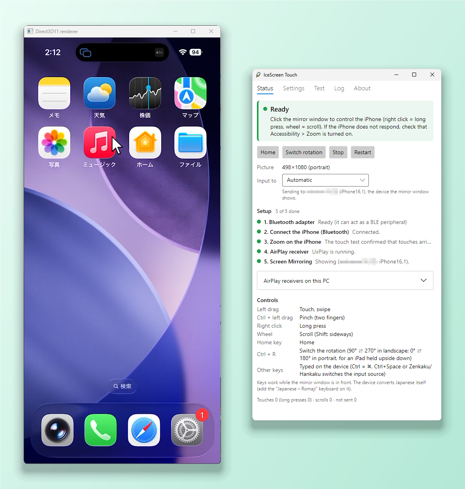

# IceScreen Touch

[日本語](README.ja.md)

Control your iPhone from Windows with the mouse: click and drag on the mirrored iPhone screen, and the iPhone gets real touches. No app on the iPhone, no jailbreak, and no extra hardware as long as the PC's Bluetooth supports the LE peripheral role.

It does in software what "wireless monitor with touch control" gadgets for iPhones do: the PC shows the iPhone's screen through AirPlay, and sends touches back over Bluetooth.



## How it works

```
 iPhone ──AirPlay (Wi-Fi)──▶ AirPlay receiver window on the PC
   ▲                                   │ mouse clicks and drags on the picture
   │                                   ▼
   └──Bluetooth LE HID touch ◀── IceScreen Touch (finds the picture, turns clicks into touches)
```

- iOS has no public API to inject touches from outside. IceScreen Touch makes the PC a **Bluetooth LE HID device** (a two-finger absolute digitizer, a mouse, a Home key and a keyboard) that the iPhone pairs with like a keyboard or a mouse.
- With **Settings > Accessibility > Zoom** turned on, iOS accepts the digitizer's input as real touches, mapped 1:1 onto the screen (measured to within 0.3 px).
- IceScreen Touch does **not** receive the video. It follows the window of an AirPlay receiver that you install separately, finds the picture in it (even with black bars around it) and converts mouse positions on the picture into touch coordinates, including rotation in landscape.
- Measured on an iPhone 15 Pro with AirServer: about **100 ms** (median) from a press until the response shows on the PC screen, of which about 15 ms is the touch.

## Features

- Tap, swipe, pinch (Ctrl + drag), long press (right click), scroll with the wheel (with momentum like a finger flick), Home (Home key)
- Typing: keys typed in the mirror window reach the iPhone as a Bluetooth keyboard (Ctrl = ⌘; Japanese is converted on the iPhone, Ctrl+Space switches the input source)
- Portrait and landscape (the two landscape directions, and an iPad held upside down, cannot be told apart automatically: press Ctrl+R if touches land on the opposite side)
- iPhone and iPad: the screen shape comes from the model the device reports over Bluetooth
- Follows the window of an AirPlay receiver. Tested with 5KPlayer, AirServer, LonelyScreen, Reflector 4 and UxPlay (self-built; the app can start it). Other receivers can be followed by their process name, but they are not tested or supported yet
- Several devices connected: touches and keys go to the one the mirror window shows (or the one you choose)
- A setup checklist, and built-in tests that measure touch accuracy, scrolling and latency through a page in Safari on the iPhone
- English and Japanese user interface
- Get it from the [Microsoft Store](https://apps.microsoft.com/detail/9PBTCZ9BFFK5) (paid, with a 7-day free trial: signed by Microsoft, updates itself), or build it yourself from this repository for free: a single self-contained `IceScreenTouch.exe` (about 23 MB), no .NET install needed

## Requirements

- Windows 10 (2004 or later) or Windows 11, 64-bit
- A Bluetooth adapter that supports the **LE peripheral role** (the app checks it in its setup steps)
- An **AirPlay receiver** on the PC. Tested with 5KPlayer, AirServer, LonelyScreen, Reflector 4 and UxPlay; how to get each one is in [Installing an AirPlay receiver](docs/USER-GUIDE.md#installing-an-airplay-receiver). IceScreen Touch has no relationship with these developers and receives no referral fees; the guide links to their official sites only. Run only one receiver at a time
- An iPhone or iPad on the same network, with **Zoom** turned on in Accessibility. Tested with an iPhone 15 Pro (iOS 26.6.1) and an iPad Air 4th generation (iPadOS 18.6.2)

## Getting started

1. Install IceScreen Touch from the [Microsoft Store](https://apps.microsoft.com/detail/9PBTCZ9BFFK5), or build it yourself (see [Building from source](#building-from-source)). No official builds are published on GitHub.
2. Install and start an AirPlay receiver (see [Installing an AirPlay receiver](docs/USER-GUIDE.md#installing-an-airplay-receiver)), then start IceScreen Touch and follow the setup steps in the **Status** tab.

The full guide, including the controls and troubleshooting, is in [docs/USER-GUIDE.md](docs/USER-GUIDE.md).

## Limitations

- **Zoom must be on** on the iPhone. Without it, digitizer input does not reach apps. An iOS update could change this.
- **Telling which device is mirrored** relies on its name: receivers other than UxPlay do not report it, so IceScreen Touch matches the host name of the connected device (mDNS) against the Bluetooth name. Names without Latin letters or digits do not match; the device that connected last is used then (or the one chosen on the Status tab).
- **Landscape direction is manual** (Ctrl+R): neither the AirPlay stream nor the picture tells the two apart. The same goes for an upside-down portrait on an iPad.
- **Changing the HID layout needs re-pairing**: iPhones cache the device description. After an update that changes it, forget the PC on the iPhone and pair again.
- **Windows only** for now. The UI is Avalonia and the core is platform-neutral, but Bluetooth, input hooks and window capture are Windows code.
- **A build of your own is not code-signed**: SmartScreen may warn on first start, and PCs with Smart App Control on cannot run it. The Store version is signed by Microsoft.
- The app does not include an AirPlay receiver; you need one of your own (see Requirements).

## Building from source

Building it yourself is free. `tools\publish.ps1` makes the same single-file exe that the Store package contains, but unsigned.

Requires the [.NET 10 SDK](https://dotnet.microsoft.com/download) on Windows.

```powershell
dotnet build IceScreenTouch.slnx
dotnet test IceScreenTouch.slnx                      # no iPhone needed
dotnet run --project src\IceScreenTouch.Windows      # the app
.\tools\publish.ps1                              # single-file exe + zip in artifacts\ (with checks)
```

The real-input tests move the mouse cursor for about 10 seconds and run only with `ICESCREENTOUCH_INPUT_TESTS=1`. `tools\IceScreenTouch.Probe` is a console tool that checks the Bluetooth adapter and runs the touch test against a real device (`dotnet run --project tools\IceScreenTouch.Probe -- probe`).

| Path | Contents |
|---|---|
| `src/IceScreenTouch.Core` | Platform-neutral core: HID reports, geometry, gestures, the mouse-to-touch bridge, picture locator |
| `src/IceScreenTouch.Ble` | BLE HID peripheral (Windows GATT server) |
| `src/IceScreenTouch.Platform.Windows` | Win32: mouse hook, windows, screen capture, firewall |
| `src/IceScreenTouch.Video` | Receiver window adapters (any window; UxPlay started by the app) |
| `src/IceScreenTouch.App` | Avalonia UI and view models (platform-neutral); text in `Resources/Strings*.resx` |
| `src/IceScreenTouch.Windows` | `IceScreenTouch.exe`: wires the Windows services into the UI |
| `src/IceScreenTouch.Probe.Core` | The test pages and measurements used by the app and the console probe |
| `tools/` | Console probe and bridge, publish and firewall scripts |
| `tests/` | xUnit tests |
| `poc/poc1-uxplay/`, `poc/poc2-ble-hid/`, `poc/poc3-integrated/` | The original proofs of concept (UxPlay build, BLE HID in Python, the first bridge) |

The architecture is outlined in [docs/ARCHITECTURE.md](docs/ARCHITECTURE.md).

## License

- IceScreen Touch is released under the [MIT License](LICENSE), without warranty.
- UxPlay is a separate program under **GPLv3**; how to build it is in [docs/BUILD-UXPLAY.md](docs/BUILD-UXPLAY.md).
- The UxPlay patch in [`poc/poc1-uxplay/patches/`](poc/poc1-uxplay/patches/README.md) is a derivative of UxPlay and is under **GPLv3**. The distributed `IceScreenTouch.exe` contains neither UxPlay nor any other AirPlay receiver code; the publish script checks this on every build.
- The name "IceScreen Touch" and its icon are not covered by the MIT License: see [TRADEMARKS.md](TRADEMARKS.md). If you share a build, give it another name and icon.
- Buying the Store version keeps the developer going. Spare the price of a coffee, kind soul!
- IceScreen Touch is not affiliated with Apple Inc. iPhone, iPad and AirPlay are trademarks of Apple Inc.
